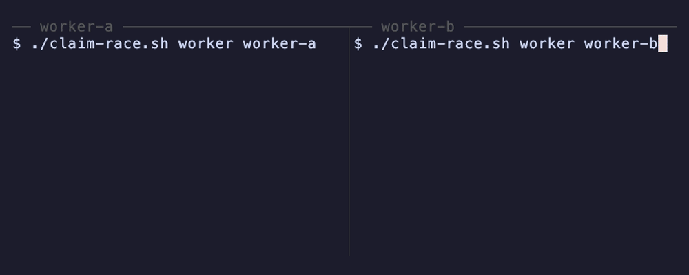
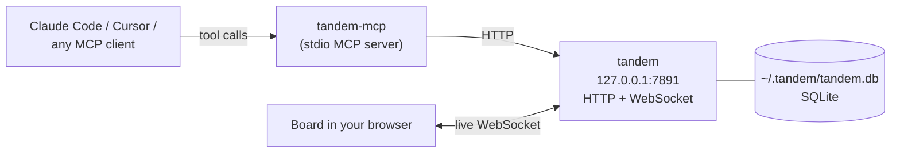
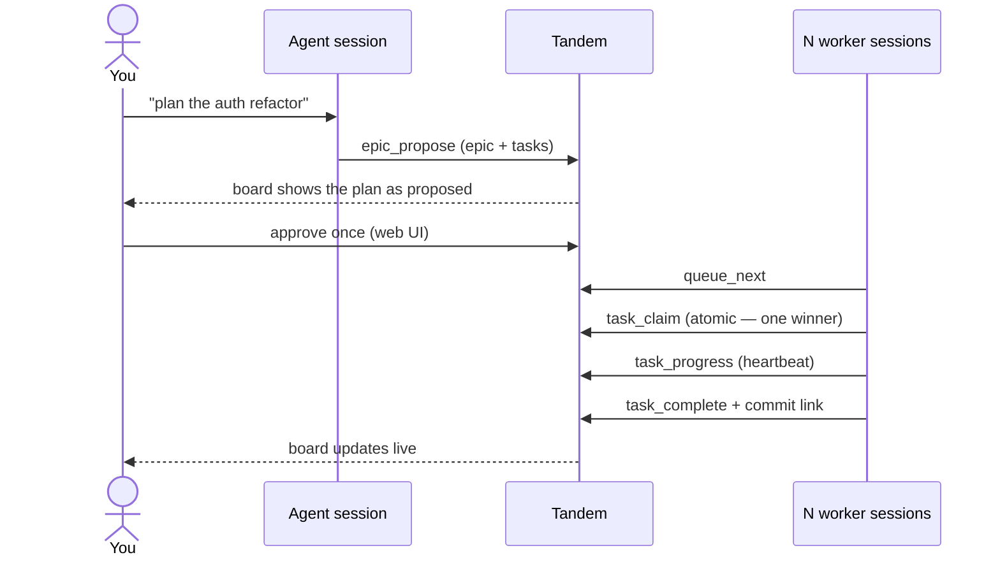
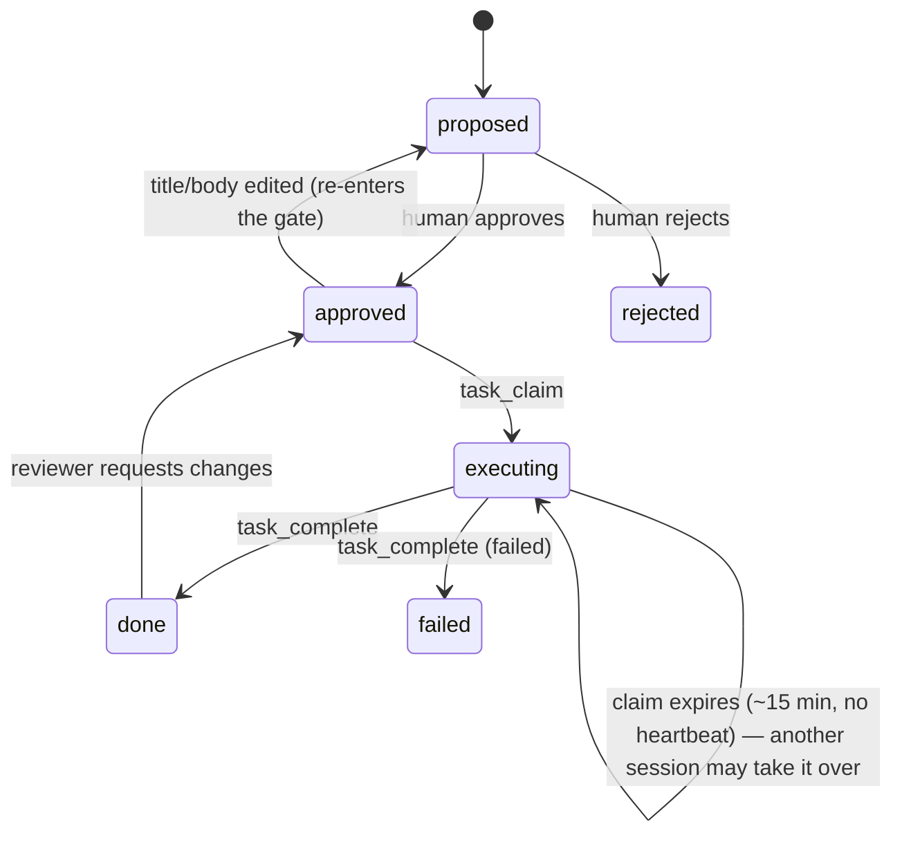

<p align="center">
  
</p>

<h1 align="center">Tandem</h1>

<p align="center">
  <strong>One task queue for the Claude Code sessions you already run in parallel.</strong><br />
  Terminals, worktrees, subagents: they claim work from one queue atomically, read one shared briefing, and only pick up what you approved.
</p>

<p align="center">
  <a href="https://tandemcanvas.com">tandemcanvas.com</a> ·
  <a href="https://github.com/jaximus808/tandem/releases">Releases</a> ·
  <a href="https://www.npmjs.com/package/@jaximus/tandem-mcp">npm: @jaximus/tandem-mcp</a>
</p>

<p align="center">
  
</p>

```bash
npx -y @jaximus/tandem-mcp setup
```

If you run more than one agent session on a repo, they probably coordinate through a TODO.md that several of them are editing at once, or that each worktree has its own copy of. A file has no notion of who holds what, and no atomic claim. Tandem keeps intent in git and moves the churn (claims, statuses, results) into a queue every session on the machine reads live. Agents propose work, you approve the plan once, N sessions pull the approved queue without colliding, and every finished task carries a commit link.

One Go binary, one SQLite file in `~/.tandem`, a board in your browser. No account, no server to rent, nothing phones home. Any MCP client works: Claude Code, Codex, Cursor, or your own script.

## Zero double-claims, enforced in tests

A claim is one conditional `UPDATE … WHERE state = 'approved'` inside a serialized transaction, so when two sessions go for the same task, exactly one wins and the other gets `{ claimed: false, claimedBy }` naming the holder. Two tests hold that line:

- [`TestClaimRaceHasOneWinner`](https://github.com/jaximus808/tandem/blob/main/apps/api/internal/store/sqlite/sqlite_test.go#L362-L421) — 8 goroutines race one real SQLite row: exactly 1 winner, 7 losers, and every loser is told who holds it.
- [`TestConcurrentWorkerClaimsProduceOneWinner`](https://github.com/jaximus808/tandem/blob/main/apps/api/internal/api/edge_claim_test.go#L281-L324) — two workers claim the same task concurrently through the HTTP handler: exactly one `200`, one `409`, and the `409` names the winner.

Run them with `cd apps/api && go test ./internal/store/sqlite ./internal/api -run 'ClaimRace|ConcurrentWorkerClaims'`.

Tandem is also planned on its own queue: more than 150 commits in this repo carry a `TDM-n` ticket (`git log --oneline | grep -c TDM-`).

## What `setup` does

The one line at the top does everything a first run needs:

1. Registers the MCP server with Claude Code at **user scope** (`claude mcp add --scope user tandem -- npx -y @jaximus/tandem-mcp`), so every project can reach Tandem. If `claude` isn't on your `PATH`, it prints the command for you to run.
2. Appends a short **Tandem** snippet to `~/.claude/CLAUDE.md` (idempotent) so plain phrases — "make me a sprint board", "an agent board", "a task board", "a tandem canvas" — map to `canvas_create` + `epic_propose` instead of a markdown file.
3. Downloads this platform's `tandem` binary from the [latest release](https://github.com/jaximus808/tandem/releases) into `~/.tandem/bin`, starts it on `http://127.0.0.1:7891`, and opens the board.

Restart Claude Code afterwards and check:

```bash
claude mcp list
# tandem: npx -y @jaximus/tandem-mcp - ✓ Connected
```

Flags: `--project` registers in the current repo's `.mcp.json` instead of user scope; `--no-claude-md` skips the snippet; `--no-open` leaves the browser alone. Cursor, Codex and any other stdio MCP client spawn the same command: `npx -y @jaximus/tandem-mcp`.

Then, in any Claude Code session: *"make me a sprint board for the auth refactor"* — the board opens with the plan on it, waiting for your approval.

## What it looks like

<p align="center">
  <a href="apps/web/public/demo/tandem-demo-full.mp4">
    
  </a>
  <br /><sub>Click for the full demo clip.</sub>
</p>

## How it works

Everything runs on one machine. The MCP server is a thin stdio proxy; the binary is the whole product.



The loop: an agent plans, you approve once, sessions claim and complete, the board moves as it happens.



A task's life. Approval is the gate; editing an approved task's content sends it back through the gate, and a claim nobody heartbeats expires so another session can take it.



Roles are simple: the browser is the human (the owner of every canvas in local mode); anything that connects with a canvas code over MCP is an agent. Agents can propose and claim; only the human can approve, reject or delete.

## Teach your sessions the loop

`setup` gives Claude the phrases. For a repo that has its own board, pin it once:

```bash
npx -y @jaximus/tandem-mcp init --write
```

That creates a canvas, writes its code into the repo's `.mcp.json` as `TANDEM_CANVAS_CODE`, and appends the snippet below to `AGENTS.md`/`CLAUDE.md`. If you'd rather paste it yourself, replace `AB3XK9QZ` with your canvas code:

````markdown
## Tandem task queue

The shared work queue for this repo is Tandem canvas `AB3XK9QZ`.

Every session:

1. `canvas_connect` with code `AB3XK9QZ` — once per session. Pass `role`
   ("executor" if you'll work tasks yourself, "planner" if you'll dispatch
   them to subagents) and a `name`. Keep the `session` handle it returns and
   pass it as `session` on every later Tandem call.
2. `queue_next` — the approved, ready-to-work queue. That is the entry point
   for work; don't go looking for it by reading the canvas. (`context_get`
   once if you need to orient on what this canvas is.)
3. Pick one task, `task_get` for its hydrated context (linked notes, roadmap
   items, its epic), then `task_claim` to claim it. The claim is atomic: if
   it returns `{ claimed: false, claimedBy }`, another session won — do NOT
   work on that task; go back to `queue_next` and take the next one.
4. Do the work. Every commit message for the task starts with its ticket
   ID, e.g. `TDM-7: add rate limiter`. On long work, `task_progress` with
   one line per meaningful step — it doubles as a heartbeat, so a task that
   runs past ~15 minutes doesn't become reclaimable underneath you.
5. `task_complete` with a `result` saying what was done and where — always
   include the commit hash(es) — plus `links` to the commit or PR.

Planning from a spec: when asked to decompose SPEC.md (or any spec file)
into work, use `epic_propose` — one epic per spec section, with that
section's tasks passed in the SAME call via `tasks`, so the human approves
once instead of task by task. In the epic body, record the spec file path,
the section heading, and the current commit SHA of the spec file. One human
approval of the epic approves its tasks (canvas approval policy `epic`, the
default); add more tasks to an existing epic later with `task_propose` and
that `epicId`. Before working a claimed task that belongs to an epic, diff
the spec section against the SHA recorded in the epic body: if the section
changed since the epic was planned, do not proceed — flag the task back
with `task_complete` using `status: "failed"` and an `error` noting the spec
drift, so the plan gets redone against the current spec.

If a task needs to deviate from the approved plan, don't silently do it —
propose the deviation with `task_propose` and `requiresApproval: true` so a
human gates it.

Dispatching subagents instead of working tasks yourself? Connect with
`role: "planner"` and paste each ready task's `handoff` block from
`queue_next` into one subagent per task — you dispatch, they claim. Never
claim a task you won't personally do, and never hand a subagent your
`session` handle; the canvas code is what travels.
````

### Go parallel

In one session, ask Claude to plan (*"read SPEC.md and propose the work on the Tandem canvas"*), approve the epic once in the browser, then open two terminals in the same repo:

```bash
# terminal 1 and terminal 2:
claude "work through the approved Tandem queue until it's empty"
```

Both pull the same queue. Each claim has exactly one winner — the loser sees `{ claimed: false, claimedBy: "…" }` and moves on. On the board, cards flip to *executing* with the claimant's name, every task carries its `TDM-n` ticket, and results with commit hashes land as tasks complete.

Want approving a task to *launch* the sessions instead of you starting them? `tandem-mcp listen` turns a `task.approved` webhook into a command — see [docs/ORCHESTRATION.md](docs/ORCHESTRATION.md). Locally that is one step: the server may deliver to `127.0.0.1` out of the box.

## Commands

All from `npx -y @jaximus/tandem-mcp <command>` (or `tandem-mcp <command>` after `npm i -g @jaximus/tandem-mcp`).

| Command | What it does |
|---------|--------------|
| `setup` | First-run onboarding: register the MCP server with Claude Code, teach it the phrases, download and start the server, open the board. `--project`, `--no-claude-md`, `--no-open`. |
| `up` | Start the local server (downloading the binary on first run) and open the board. `--port`, `--data-dir`, `--code CODE`, `--no-open`, `--foreground`. |
| `open [CODE]` | Open the board — or one canvas — in the browser, starting the server first if needed. |
| `down` | Stop the server `up` started. |
| `init` | Set up the current repo: create a canvas, write `.mcp.json`, print the agent snippet. `--write` appends it to `AGENTS.md`/`CLAUDE.md`; `--code` wires an existing canvas; `--name`, `--force`. |
| `listen --exec '…'` | Run a command when work is approved (local webhook listener). |
| *(no command)* | Run as the stdio MCP server — what your MCP client spawns. |

The MCP server also starts the backend itself the first time a tool call finds nothing listening locally, so a cold machine still works. `TANDEM_AUTOSTART=0` turns that off; `TANDEM_AUTOSTART_OPEN=1` opens the browser too.

## Where things live

| Path | What it is |
|------|------------|
| `~/.tandem/tandem.db` | Every canvas, task, note and webhook — one SQLite file. Back it up by copying it. |
| `~/.tandem/secret` | The auto-generated JWT secret (keeps tokens valid across restarts). |
| `~/.tandem/images/`, `~/.tandem/logs/` | Uploaded images; the detached server's log. |
| `~/.tandem/bin/tandem` | The downloaded binary. `TANDEM_BIN` or a `tandem` on your `PATH` wins over it. |

`TANDEM_DATA_DIR` moves the whole directory; `PORT` moves the port. The server answers `GET /healthz` and `GET /api/config` (`{auth, local, version}`). Every server setting is documented in [`apps/api/.env.example`](apps/api/.env.example) — none is required.

## Run from source

| Path | What it is |
|------|------------|
| `apps/api` | Go server — HTTP + WebSocket hub, SQLite store (`internal/store/sqlite`, pure-Go `modernc.org/sqlite`), the web bundle embedded at build time |
| `apps/web` | React + Vite + Tailwind board |
| `apps/mcp-gateway` | `@jaximus/tandem-mcp` — the stdio MCP server and the CLI above |
| `apps/tandem-next` | The Next.js landing site (tandemcanvas.com, deployed on Vercel) |
| `internal/shared` | TypeScript types shared by web + gateway |
| `scripts/build.sh` | Builds the web bundle, embeds it, cross-compiles the binary |

```bash
pnpm install
scripts/build.sh          # → dist/tandem for this machine (--all: every release target)
./dist/tandem             # local mode, data in ~/.tandem
```

Dev loop — the Go server plus Vite with HMR proxying to it:

```bash
cd apps/api && go run ./cmd/server     # http://localhost:7891
pnpm --filter web dev                  # http://localhost:5173 → proxies /api, /ws
```

Verify before committing:

```bash
cd apps/api && go build ./... && go test ./...
cd apps/web && pnpm build
cd apps/mcp-gateway && pnpm build && pnpm test
```

The schema is `apps/api/internal/store/sqlite/schema.sql`, applied by `migrate.go` (a `schema_version` table; bump `schemaVersion` and add a step when it changes). More in [docs/DEV.md](docs/DEV.md).

## Releases

The server version is `apps/api/VERSION`. Tagging it publishes the binaries:

```bash
git tag v0.1.1 && git push origin v0.1.1
```

[`release.yml`](.github/workflows/release.yml) builds darwin / linux / windows × amd64 / arm64 and attaches them (plus `SHA256SUMS`) to the GitHub Release — what `up` downloads (`TANDEM_VERSION` pins one; default latest). The gateway's npm release is separate: `mcp-v*` tags, [`release-mcp-gateway.yml`](.github/workflows/release-mcp-gateway.yml).

## MCP tool surface

The default surface is an **18-tool intent facade** shaped like the work loop: `canvas_connect`, `canvas_create`, `agent_register`, `context_get`, `queue_next`, `queue_wait`, `task_find`, `task_get`, `task_claim`, `task_progress`, `task_complete`, `task_propose`, `task_amend`, `task_review`, `epic_propose`, `doc_write`, `doc_read`, `board_status`. The raw CRUD surface (documents, notes, roadmap items, raw actions) is one opt-in away — `TANDEM_FULL_TOOLS=1` or `--full-tools`. Per-tool reference: [apps/mcp-gateway/README.md](apps/mcp-gateway/README.md#tools).

## Sharing one instance with a team

Everything above is local mode: one machine, one user, no sign-in. Running a shared instance with accounts, importing boards from the old hosted Tandem, and what the local-first move cut are in [docs/SELF-HOSTING.md](docs/SELF-HOSTING.md).
